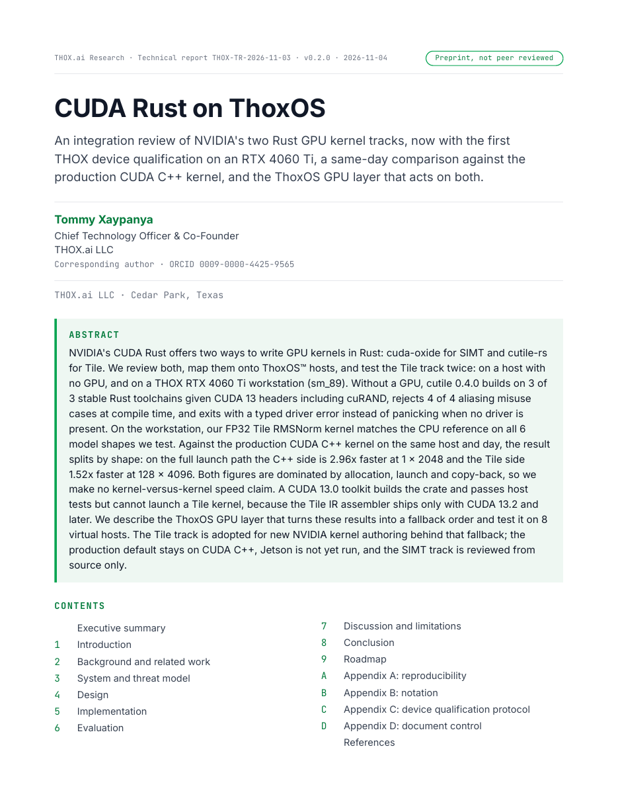

# CUDA Rust on ThoxOS

[](LICENSE)
[](https://github.com/ttracx/thox-cuda-rust-paper/commits/main)
[](https://github.com/ttracx/thox-cuda-rust-paper/releases)
[](https://thox.ai/research)
[](https://doi.org/10.5281/zenodo.23969298)

**THOX.ai Research technical report THOX-TR-2026-11-03, v0.2.0 (public edition), 4 November 2026.**
Author: Tommy Xaypanya, Chief Technology Officer & Co-Founder, THOX.ai LLC (corresponding author), Cedar Park, Texas. ORCID: [0009-0000-4425-9565](https://orcid.org/0009-0000-4425-9565).
Preprint, not peer reviewed. License: CC BY 4.0.



## About the paper

NVIDIA's CUDA Rust offers two ways to write GPU kernels in Rust: cuda-oxide for SIMT and cutile-rs for Tile. We review both, map them onto ThoxOS hosts, and test the Tile track twice: on a host with no GPU, and on a THOX RTX 4060 Ti workstation (sm_89). Without a GPU, cutile 0.4.0 builds on 3 of 3 stable Rust toolchains given CUDA 13 headers including cuRAND, rejects 4 of 4 aliasing misuse cases at compile time, and exits with a typed driver error instead of panicking when no driver is present. On the workstation, our FP32 Tile RMSNorm kernel matches the CPU reference on all 6 model shapes we test. Against the production CUDA C++ kernel on the same host and day, the result splits by shape: on the full launch path the C++ side is 2.96x faster at 1 x 2048 and the Tile side 1.52x faster at 128 x 4096. Both figures are dominated by allocation, launch and copy-back, so we make no kernel-versus-kernel speed claim. A CUDA 13.0 toolkit builds the crate and passes host tests but cannot launch a Tile kernel, because the Tile IR assembler ships only with CUDA 13.2 and later. We describe the ThoxOS GPU layer that turns these results into a fallback order and test it on 8 virtual hosts. The Tile track is adopted for new NVIDIA kernel authoring behind that fallback; the production default stays on CUDA C++, Jetson is not yet run, and the SIMT track is reviewed from source only.

## DOI and canonical copies

- **DOI: [10.5281/zenodo.23969298](https://doi.org/10.5281/zenodo.23969298)** (concept DOI, all versions: [10.5281/zenodo.23955184](https://doi.org/10.5281/zenodo.23955184))
- Zenodo record: https://zenodo.org/records/23969298
- Paper page: https://thox.ai/research/papers/cuda-rust-on-thoxos
- Hugging Face: folder `cuda-rust/` in the [Thox-ai/thox-whitepapers](https://huggingface.co/datasets/Thox-ai/thox-whitepapers) dataset
- This repository: paper PDF + interactive demo in `paper/`, evidence results in `artifact/exp/results/`

| File | SHA-256 |
|---|---|
| `paper/THOX-CUDA-Rust-on-ThoxOS-v0.2.0.pdf` (396,798 bytes) | `9aba898eea4591792e753692bb9f7776d829e8f2d8ec25dfdd2db21f01363b8f` |
| `paper/THOX-CUDA-Rust-on-ThoxOS-v0.2.0-demo.html` (197,813 bytes) | `7884c23a222c82bbeebb1a4ce397f6cdcbb77fae61e17e44b7eaaa5b9d3d1448` |

## Headline results

- First THOX CUDA Rust kernel run on a GPU: FP32 Tile RMSNorm matches the CPU reference on 6 of 6 model shapes, tolerance 1e-5 (30-run bench medians: 0.0810 ms at 1x2048, 0.3118 ms at 128x4096, full launch-path wall time).
- CUDA 13.0 builds the crate and passes host tests but cannot launch a Tile kernel: the Tile IR assembler (tileiras) ships only with CUDA 13.2 and later toolkits. The floor binds at launch, not build.
- Head-to-head against the production edge-ops CUDA C++ RMSNorm kernel, compiled verbatim from its source, same host and day: C++ launch path 2.96x faster at 1x2048; Tile 1.52x faster at 128x4096. Both figures are overhead-dominated; no kernel-versus-kernel speed claim is made.
- Tile is adopted for new NVIDIA kernel authoring on qualified hosts behind the ThoxOS GPU layer fallback (Tile, then edge-ops CUDA C++, then CPU). The production default stays on CUDA C++. Jetson/Orin not yet run. The SIMT track (cuda-oxide) is source-review only.

## Quick start

```bash
git clone https://github.com/ttracx/thox-cuda-rust-paper.git
cd thox-cuda-rust-paper
# Read the paper:
open paper/THOX-CUDA-Rust-on-ThoxOS-v0.2.0.pdf        # macOS
xdg-open paper/THOX-CUDA-Rust-on-ThoxOS-v0.2.0.pdf    # Linux
# Run the interactive demo (single file, no network needed):
open paper/THOX-CUDA-Rust-on-ThoxOS-v0.2.0-demo.html
# Inspect the evidence behind every printed number:
ls artifact/exp/results/
```

## Repository layout

| Path | Contents |
|---|---|
| `paper/` | The shipped edition: paper PDF + interactive demo HTML (canonical bytes, hashes above). |
| `artifact/exp/results/` | The evidence source: `summary.json` (GPU-less review), `device-run/` (RTX 4060 Ti qualification: run record + 30-run bench JSONs), `head-to-head/` (same-day comparison vs the production CUDA C++ kernel: method, caveats, result JSONs). |
| `artifact/wp/QA-REVIEW.md` | The non-producer review of the v0.2.0 edition (hash, byline, blocker sweep, independent numbers proof). |
| `docs/` | `USER_GUIDE.md`, `QUICKSTART.md`, `DEVELOPMENT.md`, `previews/` (rendered cover). |
| `.agents/HANDOFF.md` | Agent handoff: status, key files, conventions, open items. |
| `CITATION.cff`, `citation.bib`, `paper.bib` | Citation set. `paper.bib` is the canonical BibTeX file name (matching the THOX paper-repo template); `citation.bib` is an identical copy. |
| `LICENSE`, `NOTICE.md` | CC BY 4.0 license text and IP attribution. |

The kernel source code is not in this repository. The Tile RMSNorm crate lives in its own private repository (`ttracx/thox-tile-ops`); this repo is the paper and its evidence record.

## Documentation map

- User guide: [docs/USER_GUIDE.md](docs/USER_GUIDE.md)
- Quick start: [docs/QUICKSTART.md](docs/QUICKSTART.md)
- Development: [docs/DEVELOPMENT.md](docs/DEVELOPMENT.md)
- Agent handoff: [.agents/HANDOFF.md](.agents/HANDOFF.md)

## Releases

Formal releases live on the [Releases page](https://github.com/ttracx/thox-cuda-rust-paper/releases). Release `v0.2.0` carries the paper PDF and the demo as assets, byte-identical to `paper/`.

## Agent handoff

Agents resuming work on this repository start at [.agents/HANDOFF.md](.agents/HANDOFF.md).

## Governance note

Public publishing (social, website, store listings, public repo flips, registries, campaigns) requires Craig Ross's explicit approval via craig@thox.ai, CC tommy@thox.ai. This v0.2.0 publication proceeded on Tommy Xaypanya's explicit CTO publish order of 2026-11-04 for this paper, following the THOX Research Paper Process v1.0 (Zenodo first, then one-pass association).

## License

This work is licensed under the Creative Commons Attribution 4.0 International License (CC BY 4.0). See [LICENSE](LICENSE) and [NOTICE.md](NOTICE.md).

## Cite

```bibtex
@techreport{xaypanya2026cudarust020,
  author      = {Tommy Xaypanya},
  title       = {{CUDA} {Rust} on {ThoxOS}: An Integration Review of {NVIDIA}'s Two {Rust} {GPU} Kernel Tracks, with the First {THOX} Device Qualification on an {RTX} 4060 {Ti}, a Same-Day Comparison Against the Production {CUDA} {C++} Kernel, and the {ThoxOS} {GPU} Layer},
  institution = {THOX.ai Research, THOX.ai LLC},
  address     = {Cedar Park, Texas},
  year        = {2026},
  month       = nov,
  version     = {0.2.0},
  doi         = {10.5281/zenodo.23969298},
  url         = {https://doi.org/10.5281/zenodo.23969298}
}
```
